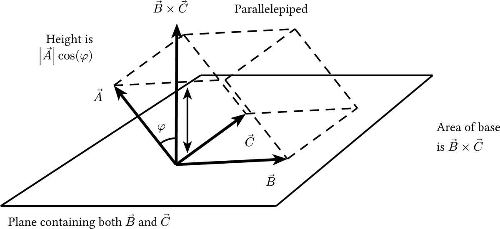
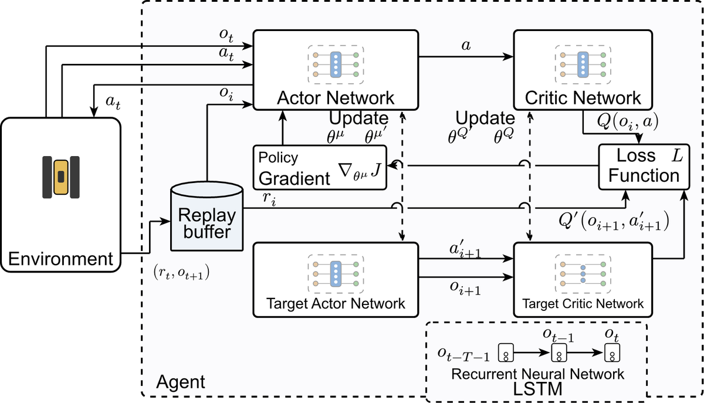

# Figure as Code · 图即代码

Paper figures compressed into compilable **Typst/CeTZ** source. Every line maps to coordinates, layering, symbols and connections in the drawing — a corpus for teaching LLMs the spatial relations inside images, aimed at AI-assisted research, engineering design and CAD.

论文插图压缩成可编译的 Typst/CeTZ 源码：坐标、层级、符号与连接关系都由代码显式写出。目标是为大模型提供「图—文—坐标」对齐语料，让模型学会图像里的空间关系，未来辅助科研绘图、工程设计与 CAD。



*平行六面体：向量合成、虚线隐藏边、夹角 φ 与高度关系全部由坐标和线段写出。*



*LSTM-DDPG 框架：模块边界、数据流方向与更新路径由方框坐标和带箭头的连线表达。*

## 为什么做这个

- 位图对语言模型是不透明的；代码把「谁在谁上方、谁连到谁、夹角朝哪边」变成可读的 token。
- 每个图是一份对齐样本：英文标签逐字保留，中文注释只解释结构关系，不替代标签。
- 可用于训练/评测空间理解、图生代码模型微调，或作为科研绘图检索与复用语料。

## 内容

- `figures/batchNN/typ/*.typ`：359 个自包含图文件（235 个批次）。
- 以线稿与示意图为主：几何、向量、物理、控制框图、推进系统、材料机理、AI 网络架构。
- 统一依赖 Typst 0.15.1 与 CeTZ 0.4.2，文件首部即页面与依赖设置。
- 一个文件一张图，标签与论文原图一致，不使用外部图片资源。

## 编译

```bash
typst compile figures/batch24/typ/fig74-parallelepiped.typ out.png --ppi 300
typst compile figures/batch287/typ/lstm-ddpg-framework.typ out.pdf
```

## 目录

```
figures/batchN/typ/*.typ   # 单图源码，一个文件即完整图
assets/                    # 通用图元源码与 README 预览图
```

## 质量检查

- 渲染后先做文字重叠 / 线条穿字的脚本筛查，再做视觉复核。
- 箭头尖一律实心；虚线只作用于线身，不作用于箭头。
- 标签压线时移动标签或留出断线留白，不用白块盖住结构线。

## 版权

- 重绘源码以 MIT 许可发布（见 `LICENSE`）。
- 原始插图版权归各论文作者所有，本仓库仅用于研究与教学。
